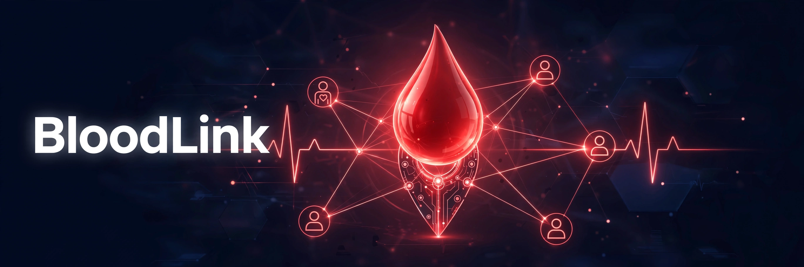
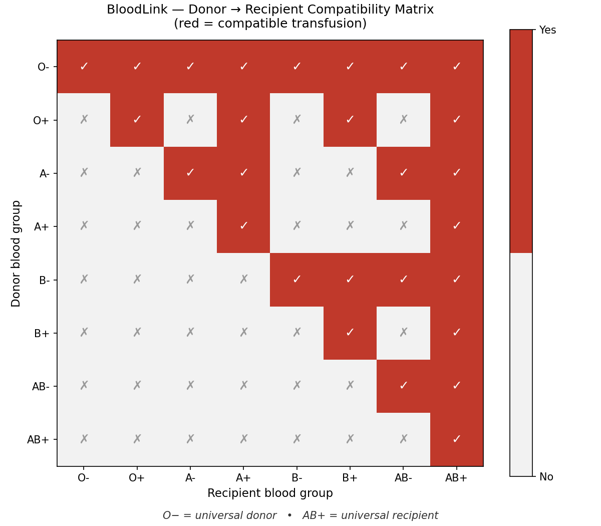
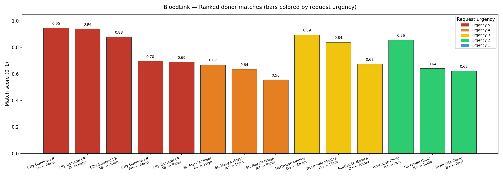

# 🩸 BloodLink

**Find a compatible blood donor nearby — in seconds, not hours.**

[](https://www.python.org/)
[](#-demo)
[](LICENSE)
[](https://sdgs.un.org/goals/goal3)
[](#-tech-stack)

> Supports **UN Sustainable Development Goal 3 — Good Health and Well-being** (target 3.8: universal health coverage, including access to safe, quality essential health-care services).

---

## 🎯 The Problem

In an emergency — a car crash, a complicated delivery, emergency surgery — hospitals need blood **now**. But finding a *compatible* donor nearby is still a slow, manual process of phone trees and group chats. Every minute of delay is a minute a patient can't afford, and a mistyped blood group can be fatal: transfusing incompatible blood triggers a potentially lethal hemolytic reaction.

## 💡 The Solution

**BloodLink** is an offline-first donor ↔ request matching engine:

1. **Registries** — donors (blood group, location, last donation, availability) and hospital requests (group needed, units, urgency 1–5) in SQLite.
2. **Medically correct compatibility engine** — full ABO/Rh donor→recipient rules (O− universal donor, AB+ universal recipient; Rh+ never goes to Rh−).
3. **Smart matching** — every request gets ranked donors by an urgency-weighted score: compatibility exactness + proximity + urgency, with the 56-day donation cooldown enforced.
4. **Instant alerts** — simulated SMS-style notifications ping matched donors, logged for audit.
5. **Blood drive scheduler** — plan drives by date, location, and target blood groups.

## 🚀 Demo

Runs out of the box — no API keys, no network, no setup beyond `pip install`:

```bash
pip install -r requirements.txt
python3 -m bloodlink.cli demo
```

This seeds 16 donors, 5 hospital requests and 3 blood drives, then runs the full pipeline: compatibility matrix → urgency-weighted matching → donor SMS alerts → drive list → charts.

**Sample match output** (real run — see `assets/demo_terminal.txt`):

```
[Request #1] 3u O- urgency=5/5 @ City General ER
   0.946  Aarav Sharma     O-   dist=1.4
   0.939  Kabir Singh      O-   dist=1.6

[Request #4] 2u AB- urgency=5/5 @ City General ER
   0.878  Arjun Patel      AB-  dist=3.2
   0.696  Aarav Sharma     O-   dist=1.4
```

**Sample alert** (also printed + logged to SQLite):

```
[BloodLink SMS -> Aarav Sharma] URGENT: City General ER needs 3 unit(s) of O-
blood (urgency 5/5). You (O-) are a match (score 0.95). Reply YES to confirm donation.
```

**More CLI:**

```bash
python3 -m bloodlink.cli donors                      # donor registry
python3 -m bloodlink.cli requests                     # open requests
python3 -m bloodlink.cli match --today 2026-10-01    # rank matches
python3 -m bloodlink.cli notify --channel sms        # send simulated alerts
python3 -m bloodlink.cli compat --donor O- --recipient AB+   # compatibility check
python3 -m bloodlink.cli chart                       # regenerate charts
python3 -m bloodlink.cli drives --schedule 2026-11-01 "Town Hall" "O-,B+"
python3 -m pytest                                    # 79 tests
```

## ✨ Features

| Feature | Details |
|---|---|
| 🧬 Medically correct ABO/Rh engine | Full 8×8 donor→recipient matrix; Rh sensitization rules enforced |
| ⏱️ Cooldown enforcement | 56-day whole-blood interval; unavailable donors excluded |
| 🎯 Urgency-weighted scoring | `0.5·exactness + 0.3·proximity + 0.2·urgency`; critical requests served first |
| 📲 Donor alerts | SMS-style notifications, persisted to `notifications` table |
| 🗓️ Drive scheduler | Schedule/list upcoming blood drives with target groups |
| 📊 Visuals | Compatibility heatmap + urgency-colored match-score chart (matplotlib) |
| 💾 SQLite registries | Donors, requests, drives, notifications — zero-config |
| 🔌 100% offline | No API keys, no network calls, runs anywhere |

## 🛠️ Tech Stack

- **Python 3.12** — stdlib only for core logic (`sqlite3`, `argparse`, `datetime`)
- **NumPy + Matplotlib** — compatibility heatmap & match-score charts
- **pytest** — 79 real tests, incl. the full 8×8 matrix verified against the medically correct table
- **SQLite** — registries & notification log

## 📸 Screenshots

### Compatibility matrix heatmap (real output)


### Ranked match results (real output, bars colored by urgency)


### CLI match output

Full terminal transcript: [`assets/demo_terminal.txt`](assets/demo_terminal.txt) (an excerpt is shown in [Demo](#-demo) above).

## 📁 Project Structure

```
bloodlink/
├── bloodlink/
│   ├── __init__.py        # package version
│   ├── compatibility.py   # ABO/Rh engine: is_compatible, exactness, 8×8 matrix
│   ├── database.py        # SQLite registries: donors, requests, drives, notifications
│   ├── matcher.py         # eligibility (56-day cooldown) + urgency-weighted scoring
│   ├── notify.py          # simulated SMS/console donor alerts (+ DB logging)
│   ├── demo_data.py       # bundled demo: 16 donors, 5 requests, 3 drives
│   ├── visuals.py         # matplotlib: compatibility heatmap, match chart
│   └── cli.py             # full CLI (seed/match/notify/drives/chart/demo/…)
├── tests/
│   └── test_bloodlink.py  # 79 tests incl. hardcoded medically-correct 8×8 table
├── assets/
│   ├── hero.png                  # hero banner
│   ├── compatibility_heatmap.png # real output
│   ├── match_results.png         # real output
│   └── demo_terminal.txt         # real CLI transcript
├── requirements.txt
├── LICENSE
└── README.md
```

## 🗺️ Roadmap

- [ ] Real SMS via Twilio / push notifications for critical (urgency 5) requests
- [ ] Live map UI (Leaflet) with donor/request pins and drive locations
- [ ] Donor deferral rules (hemoglobin, travel, medication screening questionnaire)
- [ ] Multi-unit fulfillment planner (split a request across nearest donors)
- [ ] Hospital dashboard + request lifecycle (open → fulfilled → closed)
- [ ] FHIR-compatible export for hospital blood-bank systems

## ⚠️ Medical disclaimer

BloodLink is a **hackathon demo**, not a medical device. Compatibility logic follows standard transfusion-medicine rules, but real transfusions require certified blood-bank crossmatching. Do not use this to make clinical decisions.

## 📄 License

MIT — see [LICENSE](LICENSE). Copyright (c) 2026 Parth (872000).
